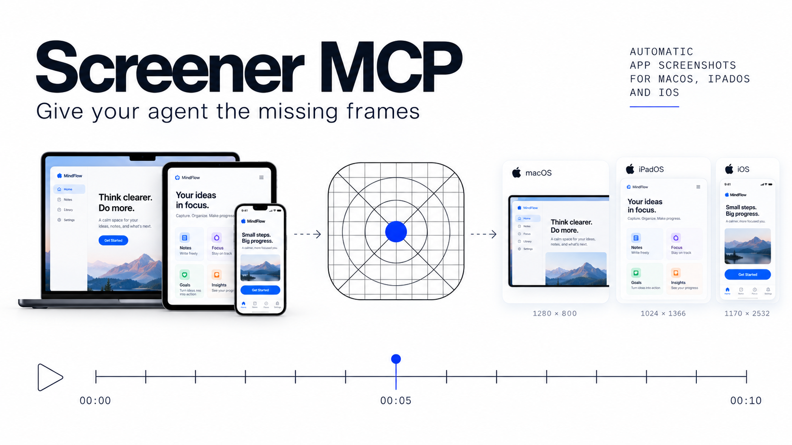

# Screener App Store screenshots

Produce a repeatable local command that opens the app, navigates its real controls,
captures named UI states and delivers native PNGs with a labelled review gallery.
The first integration adds app/test code; later runs reuse that scenario. The runner
does not discover arbitrary app navigation or generate a marketing composition.
It uses ScreenerKit inside the app and local Xcode/Python tools; no Screener MCP
server or screen-recording session is needed for these adapters.

## Choose the task and platform

| Task | Start here |
| --- | --- |
| First integration | Inspect the consuming app, install the matching adapter, add readiness/scenario/configuration. |
| Repeat an existing batch | Read its config, scenario and tool provenance; reuse them without reinstalling. |
| Recover PNG preparation | With complete collection, use `--prepare-output RUN`; no app launch or navigation. |

| Platform | App / XCTest API | Copied runner | Instructions |
| --- | --- | --- | --- |
| iOS/iPadOS Simulator | `ScreenshotProbe` / `ScreenshotScenario` | `screenshots/tools/run.py` | Read [Simulator integration](references/integration.md). |
| macOS, Apple Silicon (experimental) | `MacScreenshotProbe` / `MacScreenshotScenario` | `screenshots/tools/run_macos.py` | Read [macOS integration](references/macos.md), including permissions and window fit. |

Both paths use the shared collector and PNG preparer. macOS captures an explicitly
queried whole window, including its title bar; it does not crop the desktop.
Automatic Duo unfolding, physical-device capture and Apple upload are outside these
runners. For transient UI diagnosis or physical traces, use `screener-visual-trace`.

## Workflow

1. **Define the matrix.** Inspect repository instructions, project tooling, scheme,
   SDK pin, fixtures, UI-test target and accessibility identifiers. Choose screens,
   languages, appearance and native device/orientation or window point/pixel profiles.
   Use deterministic app-owned content; identify visible Debug controls and fixtures.
   A configured profile is not evidence that it was exercised.
2. **Integrate if missing.** Follow the selected platform guide. The installer copies
   assets without overwriting and records their hashes; it does not edit the project
   or create a runnable scenario/config. Wire the copied sources and compatible
   ScreenerKit through existing project tooling. Keep new instrumentation behind
   `SCREENER_SCREENSHOTS`, runtime opt-in and a valid run UUID, with an isolated bundle
   ID; UIKit also requires Simulator. Preserve existing tracing/dependency scope.
3. **Supply app semantics.** Add app-owned readiness and presentation IDs to probes;
   keep policy in the consuming app's policy framework. Add a scoped XCTest class
   with real navigation, content/language assertions, named checkpoints and a runtime
   opt-out check. A Boolean readiness result plus stable geometry does not prove map
   tiles, network content or every animation settled. Fixture injection does not
   establish that an import/picker flow was exercised.
4. **Run the copied command.** Use the guide's config and commands. Build is the default;
   use `--skip-build` only for the intended existing binary, whose hash is recorded.
   Reuse one project/DerivedData, serialize builds and wait on the actual process.
   Restore the normal project generation afterward when the capture config generated
   a different project; runners do not do this automatically.
5. **Verify and select assets.** Require `manifest.json` state `complete`, the requested
   matrix/checkpoint order, passing executed XCTest scenarios, closed consecutive
   traces, native geometry and decoded pixel-preserving preparation. Inspect
   `review.html` and the actual selected PNGs. Use `png/system/<locale>/<orientation>/`
   as the store-image candidates; `png/screener/` contains hierarchy comparisons.
   Counts include both backends: 2 languages × 2 orientations × 4 checkpoints means
   16 UI states, 16 system images and 16 Screener images.
6. **Hand off reproducibly.** Give the consuming command/config, output directory,
   selected PNG paths and checked matrix, plus binary/fixture/tool identities, test
   outcomes and remaining limits. Keep failures and recovery separately attributed.
   Report integration, build, capture, preparation and review costs separately;
   elapsed time and frame counts do not measure model-token or billed-cost savings.

## Recovery and fidelity

Preserve logs, xcresults and partial traces after failure. Preparation-only recovery
requires complete collection and rechecks raw hashes and closed timelines. Incomplete
collection needs a new capture run. Read the platform guide before repairing startup,
permissions, sandbox paths or geometry; do not erase user simulators or bypass trust.

The preparer retains native RGB8/RGB16 pixels and source color space, removes only
opaque alpha and normalizes EXIF without resizing. UIKit hierarchy capture omits
system status chrome, and UIKit/AppKit can differ from system captures for glass.
For Metal/RealityKit, inspect actual system PNG content: AppKit omitted MTKView in
the Dreams pilot despite correct geometry. No universal GPU fidelity is established.

Neither supplied path needs screen-recording consent; macOS still needs XCTest
automation permissions. Native pixels, passing tests and a complete batch do not
establish final store suitability or Apple acceptance. Review content and current
store requirements before a separately authorized upload.

See [validation and consumer evidence](references/validation.md) for exactly what
was exercised and which results predate later adapter/consumer changes.
