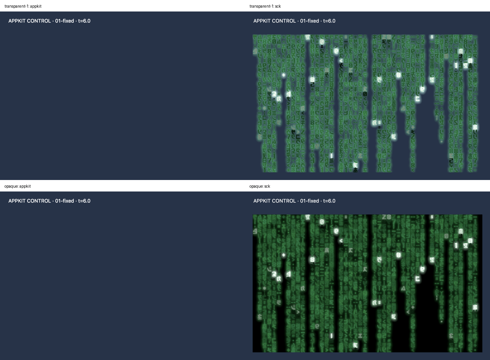

# Packaged ScreenCaptureKit backend: Dreams

Local validation, 2026-10-12. This is a working-source implementation, not a tagged
release. The historical [consumer-local pilot](../metal-2026-10-12/README.md)
remains unchanged. [ADR-0006](../../adr/ADR-0006-capture-backends-and-custom-frame-ingestion.md)
records the module and ingestion contracts.

## Bottom-up implementation

1. **Frame ingestion in ScreenerKit:** keep the existing direct CGImage API;
   add copying raw RGBA8/BGRA8, encoded/CI/platform image and CVPixelBuffer conversion,
   plus CapturedFrame/CMSampleBuffer source PTS handling. No Core format change.
2. **Optional module:** ScreenerScreenCaptureKit depends on Kit and supplies a
   macOS 14+ explicit-window/PID still source with existing authorization and native
   geometry checks. It uses the same recorder as custom sources. It is not a stream.
3. **Consumer:** Dreams uses the local optional product under its pilot flag;
   its GPU readback uses the public BGRA8 converter. Normal builds retain 0.1.0.

## Observed result

All **14 native SCK/system comparisons** are exact RGB matches at **1280×880, 2×**:
MAE 0, maximum difference 0, 100% exact pixels. Repeated fixed frames also match.
Profiles: transparent twice (2+2), opaque (2), live between paused checkpoints (6),
production `framebufferOnly=true` (2). AppKit still omits the Metal image in each case.



A separate audit decoded all 14 SCK frames stored inside `.vtrace`: each matches
its system reference and has native geometry, backend/window metadata and a
consecutive closed timeline. See [trace-audit.json](trace-audit.json).
Representative native files: [SCK](production-sck.png), [system](production-system.png),
[AppKit](production-appkit.png). No source image was resized for measurement.
The contact sheet alone is downsampled for presentation.

## Identities and reproduction

- [Identity and source bindings](identity.json): Dreams base/working sources,
  package manifest hash and absolute raw evidence location.
- [Run/build metrics](run.json): executable hash and exact Screener Swift-source
  hashes linked from the local checkout. Those source hashes were checked against
  current source before publishing this report.
- [Analysis](analysis.json): original PNG hashes, native comparisons and live changes.
- Per-profile manifests and full timelines are preserved beside this report.
- [Reproducible Dreams integration patch](dreams-pilot.patch), checked against
  public Dreams base `c55774a`; apply it to that base in a separate checkout
  using `git apply --unidiff-zero dreams-pilot.patch` (zero-context snapshot).
- [Normal build](normal-build.json): ordinary Release build passed with no pilot
  marker; its dependency pins remain unchanged. Compiler time excludes resolution.

From `/Users/egor/Development/GitHub/.worktrees/Dreams-metal-pilot`:

```sh
rtk proxy make capture-metal-pilot SCREENER_PATH=/path/to/Screener
rtk proxy /Users/egor/Development/GitHub/Dreams/.venv/bin/python \
  scripts/analyze-metal-pilot.py artifacts/metal-pilot/<run>
```

The wrapper explicitly sets the local package override only with the pilot flag,
checks the opt-in binary marker, runs five bounded fixture processes and retains
native PNGs/traces. `--skip-build` is allowed only with a cached packaged-pilot
binary; the final cache now holds a normal build, so rebuild for the next probe.
Existing Screen Recording access was present. No permission request/TCC mutation
or desktop capture was performed. The original Dreams checkout remained clean.

`screenCaptureKitRecordMS` includes shareable-window discovery, capture and awaited
recording. It is not directly comparable with the older capture-call-only metric.
Run timings are observations, not a sustained performance budget.

## Checks and limits

Passed locally:

- ScreenerKit and the optional macOS target build.
- iOS device and Simulator target builds (macOS symbols excluded; physical-iOS
  session remains in Kit). Final DocC build recompiles device and macOS source.
- Package dump confirms Core has no dependencies, Kit depends only on Core, and
  the optional module depends only on Kit.
- iOS/macOS DocC with warnings-as-errors; module/pages/tutorial validation and
  compile checks for existing and custom-frame article snippets.
- Fresh packaged Metal probe, native pixel analysis, trace decoding/provenance.
- Normal Dreams Release compilation with unchanged release dependency pins.

Runtime custom-input coverage is **raw BGRA8 only** in this pilot. Other converters
have compilation evidence; malformed inputs, orientation/color matrices, producer
memory reuse, permission denial/window disappearance and cancellation paths do not
yet have application-test evidence. No application test suite was added or run.

YUV/planar and HDR buffers are explicitly unsupported by the new copying converter.
RealityKit, HDR/EDR fidelity, protected content, occlusion, multimonitor/scale changes
and continuous capture remain unverified. Rendering is paused for each paired
capture; system screenshots and SCK may share compositor implementation. Equality
is agreement with that reference, not independent colorimetric proof.

The separate BuildHunter screenshot-runner startup blocker is unaffected. No App
Store acceptance or CI result is established by this local report.
